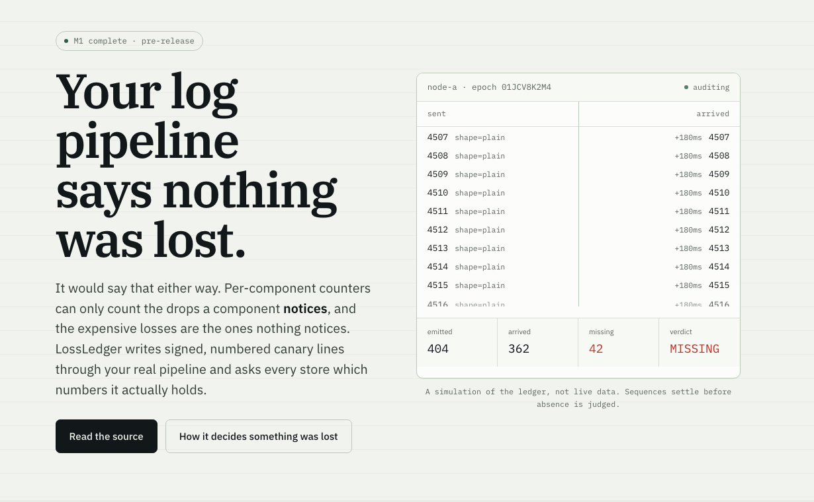

# LossLedger

**Double-entry bookkeeping for logs.** Sent is one side of the ledger, arrived is the other, and the books must balance.

[](https://lossledger-canary.vercel.app)

<p align="center">
  <a href="https://lossledger-canary.vercel.app"><b>Live demo</b></a> ·
  <a href="https://lossledger-canary.vercel.app/methodology">Methodology</a> ·
  <a href="https://lossledger-canary.vercel.app/disclosure">Disclosure policy</a> ·
  <a href="docs/launch-plan.md">Launch plan</a>
</p>

LossLedger is a black-box, end-to-end delivery auditor for log pipelines. A tiny emitter writes sequence-numbered, signed canary lines through your real pipeline, in realistic shapes. A verifier then asks each store which sequence numbers it actually holds, and reports exact gap ranges, duplicates, ordering anomalies and delivery latency.

It never touches the pipeline under test. The emitter is just another log producer; the verifier is just another query client.

## Why this exists

Per-component drop counters can only count the drops a component notices. The losses that hurt are the ones nobody counts:

- **Discovery races.** A short-lived pod writes and exits before the agent's file-discovery interval fires. Nothing increments.
- **Rotation races.** A file rotates mid-read and the lines in the gap window vanish.
- **Semantic drops.** A source silently skips lines whose timestamp is earlier than the previous line, which stdout and stderr interleaving triggers constantly.
- **Ingest rejections.** The store rejects a document after the agent already counted it as delivered.

Documented cases:

- **grafana/alloy #7076** (Sep 2026): a user-run canary measured **199 of 5,035 entries lost over 14 hours**, because out-of-order timestamp lines were silently dropped. Zero errors reported anywhere.
- **fluent/fluent-bit #2509 and #2955**: pods silently stopped shipping for hours. "I didn't find any errors in fluent bit as well as elasticsearch." In and out counters matched while logs vanished.
- **Elastic Discuss, "Losing logs in ELK"**: logs lost "often and sometimes in a massive way" while Logstash in, filtered and out stats were "almost the same". The counters lied.
- **UK Ministry of Justice Cloud Platform** (2024-07-25): the log store stopped receiving, a human noticed via Slack about 40 minutes later, and the runbook closes with "These logs have not been recovered."

Four organisations independently built this harness internally (AWS, Grafana, VictoriaMetrics, OpenTelemetry). None of them ships a generic, multi-collector, real-store version, because a neutral cross-vendor auditor belongs to nobody's roadmap.

## Status

**M1 complete. Pre-release, not yet usable against a real store.**

What works today:

- The LL1 wire format with HMAC signing and forward-compatible parsing
- An emitter with plain, JSON, stack-trace, oversize and interleave shape profiles, self-rotating file output and stdout output
- Epoch handling that tells a clean shutdown from a crash, so a restart never looks like a gap
- A verifier with roaring-bitmap ledgers, an adaptive settle window, a mandatory re-check, and the full anomaly taxonomy
- The `filesink` reference adapter and the self-validation gate
- Prometheus metrics and text or JSON gap reports

Not built yet: the Elasticsearch, ClickHouse and Loki adapters (M2), the collector testbed and fault injectors (M3), and the cross-collector loss matrix (M4).

## Quick start

```sh
go build -o lossledger ./cmd/lossledger
export LOSSLEDGER_HMAC_KEY="any-shared-secret"

# Check the environment.
./lossledger doctor -filesink /tmp/canary

# Emit and verify against a directory acting as a store.
mkdir -p /tmp/canary
./lossledger run -dir /tmp/canary -count 1000
```

Then prove the harness itself is honest:

```sh
./lossledger selfcheck
```

This runs two reference collectors in-tree. One copies faithfully and must come back clean. The other drops a known range, duplicates another and truncates multi-line events, and must be caught with exactly those ranges. If the gate fails, nothing this build says about a real pipeline is worth reading.

## How it decides something was lost

An accusation has to be earned twice. A sequence is only reported `MISSING` when all four hold:

1. It is at or below the epoch's expected high-water mark.
2. The sink does not hold it.
3. The adaptive settle window has elapsed, where `settle = clamp(max(sink_hint, p99_latency * 3), 5s, max_wait)`.
4. A mandatory re-query has run and it is still absent.

If a sequence we declared missing later arrives, `lossledger_false_missing_total` increments and the sequence is reclassified `LATE`. That metric must be zero in every published run. A nonzero value is a bug in this verifier, not in your pipeline, and it is treated as higher priority than any feature.

## Anomaly taxonomy

| Anomaly | Meaning | Severity, and exit code |
|---|---|---|
| `MISSING` | Absent after settle and re-check. Exact ranges reported. | 40 |
| `DUP_BUG` | Duplication outside a replay window, or past the factor bound. | 30 |
| `ORDER` | Arrival order violated sequence order, or a multi-line event arrived partially. | 20 |
| `LATE` | Arrived after settle but before max_wait. | 10 |
| `CLEAN` | Everything accounted for exactly once. | 0 |
| `DUP_REPLAY` | Expected at-least-once duplicate after a restart. Informational, never a failure. | 0 |

A harness error exits 2, deliberately below every anomaly, so a crash can never be mistaken for a finding.

## Limitations, stated up front

**Most teams tolerate one to two percent log loss without noticing**, because most log lines are never read. This tool is for teams where logs are legally or contractually load-bearing, platform teams who already build this internally, and engineers mid-incident who just found the missing line. That is a top-ten-to-twenty-percent-of-logging-operations tool plus a homelab tail. Thousands of deployments, not hundreds of thousands.

Also true of v1:

- Logs only. No metrics or traces.
- Attribution is source-side versus sink-side only. Per-hop attribution across a broker is v2.
- Linux is the target. The Go code is portable, but fault injection and journald are not.
- No remediation. LossLedger proves loss; it does not repair it.
- A clean result means this pipeline delivered these canaries under these conditions. It is not a proof that nothing is ever lost.

Canary lines cost money in billed stores. The default rate is capped at 100 lines per second per source, and at 10 lines per second a node produces roughly 864,000 lines per day.

## License

Apache-2.0.
